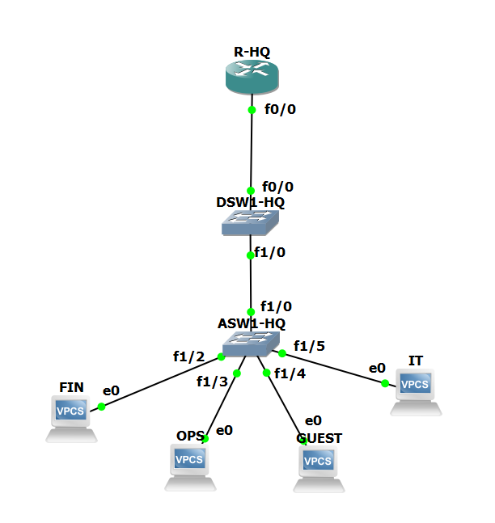

# Phase 1 Results: HQ LAN

Scope: VLANs, 802.1Q trunk, STP root, inter-VLAN routing on HQ-DSW1, centralized DHCP on HQ-R.
Devices: HQ-R (c7200), HQ-DSW1 and HQ-ASW1 (c3745 + NM-16ESW), 4 VPCS (FIN, OPS, GUEST, IT).

In Phase 1 there is no HSRP yet, so HQ-DSW1's SVIs use the `.1` gateway address of each subnet.
Configs: [`configs/phase1/`](../../configs/phase1/)

## Acceptance tests

| Test | Expected | Result | Evidence |
|---|---|---|---|
| Every VPCS runs `ip dhcp` | Address from its own VLAN's pool, outside the excluded range | Pass | [01_dhcp_binding.txt](01_dhcp_binding.txt) |
| DHCP relay on the DSW1–HQ-R link | Relay traffic is unicast; server picks the pool from giaddr | Pass | [02_dora.pcapng](02_dora.pcapng) |
| FIN → OPS, OPS → GUEST ping and trace | Ping succeeds (no ACLs yet); one routed hop through the gateway | Pass | [03_ping_trace.txt](03_ping_trace.txt) |
| Does FIN's ARP reach the OPS port? | No | Pass | [04_arp_ops.pcapng](04_arp_ops.pcapng) |
| `show spanning-tree` on DSW1 | DSW1 is root for every VLAN, priority set by hand | Pass | [05_stp_dsw1.txt](05_stp_dsw1.txt) |
| `show interfaces trunk` on ASW1 and DSW1 | Native 999, only the VLANs in use allowed, both sides identical | Pass | [06_trunk_asw1_dsw1.txt](06_trunk_asw1_dsw1.txt) |
| IP plan vs 3-year growth | Every subnet fits, with headroom | Pass | [docs/ip-plan.md](../../docs/ip-plan.md) |

## DHCP leases

| VPCS | VLAN | Address | Lease |
|---|---|---|---|
| FIN | 20 | `10.10.0.204` | 1 day |
| OPS | 30 | `10.10.0.5` | 1 day |
| GUEST | 50 | `10.10.0.139` | 4 hours (`lease 0 4`) |
| IT | 10 | `10.10.1.43` | 1 day |

## Observations

**DHCP relay (02_dora.pcapng, FIN renewing its address)**

| Frame | Source → Destination | What it is |
|---|---|---|
| 9 | `10.10.0.203 → 10.10.255.1` | Release of the old address |
| 13, 15 | `10.10.0.193 → 10.10.255.128` | Discover relayed by the FIN SVI to HQ-R's loopback (the helper address). giaddr = `10.10.0.193` |
| 14, 17 | `10.10.255.1 → 10.10.0.204` | HQ-R pings the address it is about to offer, to check that no one is using it |
| 18 | `10.10.255.1 → 10.10.0.193` | Offer of `10.10.0.204`, unicast back to the relay (giaddr) |
| 19 / 20 | same path | Request relayed to the loopback / Ack back to the relay |

- The client broadcasts its Discover and Request; DSW1 turns them into unicast to the helper address.
- giaddr `10.10.0.193` falls inside `10.10.0.192/26`, so HQ-R answers from the FIN pool.
- Requests go to HQ-R's loopback, but HQ-R answers from its outgoing interface address `10.10.255.1`.

**Inter-VLAN routing (03_ping_trace.txt, 04_arp_ops.pcapng)**

- The trace has two hops: the gateway of the source VLAN, then the destination. The final "port unreachable" is the normal end of a VPCS trace (it probes with UDP).
- On the OPS cable, requests from FIN arrive with TTL 63 (routed once by DSW1); OPS's replies leave with TTL 64.
- OPS ARPs only for its own gateway `10.10.0.1` (frames 7–8) and sends its replies to DSW1's MAC `c4:02:06:9a:00:00` while the IP destination stays `10.10.0.204`. No ARP from FIN reaches the OPS port.

**STP (05_stp_dsw1.txt)**

- All 7 VLANs that cross the trunk (1, 10, 20, 30, 40, 50, 999) show "We are the root of the spanning tree" at priority 4096.
- NM-16ESW gives each VLAN its own bridge MAC (`c402.069a.0000` to `.0006`) instead of adding the VLAN ID to the priority.

## Problems found and fixed

| Problem | Cause | Fix |
|---|---|---|
| IT's VPCS got `10.10.1.36` from DHCP, saw HQ-ASW1 already using it, and declined (`IP/MASK 0.0.0.0/0`) | The MGMT pool only excluded the gateways `.33 – .35`, while HQ-ASW1 has the static address `.36`. The first IP plan listed one "host range" and did not separate static and DHCP ranges | Excluded `.33 – .42` and split the IP plan into excluded and DHCP ranges |
| After the exclusion was fixed, IT was offered `.36` again | HQ-R kept the old binding for that client; changing `excluded-address` does not remove existing bindings | `clear ip dhcp binding 10.10.1.36` and `clear ip dhcp conflict *` |
| `%CDP-4-DUPLEX_MISMATCH` on HQ-R Fa0/0 | Fa0/0 on the c3745 came up half duplex | `speed 100` and full duplex on both ends |
| VLANs disappeared after closing the project | NM-16ESW keeps VLANs in `vlan.dat`, which was not kept | See [platform limitations](../../docs/platform-limitations.md) |
